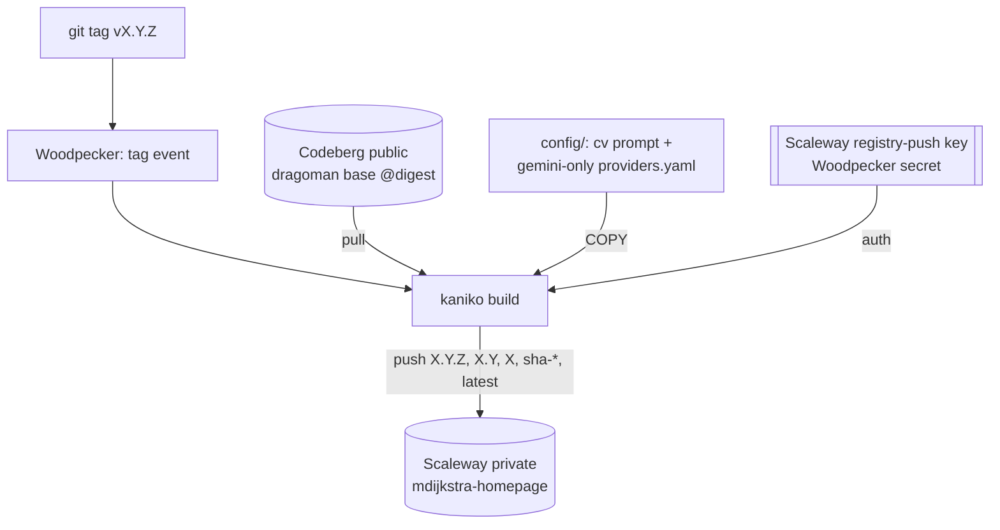

# Site Prompts Image Release - Plan

## Goal Capsule

- **Objective:** Package this repo's Dragoman prompt bundle (the `cv` portfolio-chat prompt plus a trimmed `providers.yaml`) into a self-contained, versioned Docker image built on the published Dragoman base, and publish it on git tag to the private Scaleway registry with semver, git-SHA, and `latest` tags. Includes the infra-side registry-push credential this needs.
- **Product authority:** Maintainer (Matthijn). This plan owns two repos: this repo (image + config + pipeline) and the infra repo (a new registry-push IAM identity). Running or deploying the published image is not active scope.
- **Open blockers:** None.

## Product Contract

### Summary

This repo becomes a thin packaging layer over Dragoman: a `Dockerfile` that is `FROM` the published `codeberg.org/mdijkstra/dragoman` base (digest-pinned) and copies a `config/` bundle into it, plus a tag-triggered Woodpecker pipeline that publishes the resulting image to the private Scaleway registry `mdijkstra-homepage`. The infra repo gains a dedicated registry-push IAM identity to authenticate that push. All code and wiring are authored, applied, and validated; cutting the first release tag is a deliberate manual go-live step outside this unit.

### Problem Frame

Dragoman is the engine — it ships as a generic binary that mounts its config at `/config` at runtime (reed repo, `Dockerfile:22-28`; README "Run with Docker"). Nothing currently turns *this site's* config — the `cv` prompt and its provider aliases — into a deployable, versioned artifact. To run the portfolio chat behind mdijkstra.dev, the config has to reach a server somehow, and mounting loose files gives no single immutable thing to pull, pin, or roll back. The private Scaleway registry namespace exists (infra repo, `registry.tf:1-7`) but nothing publishes to it, and infra has no credential that can push to it — its only CI identity grants object-storage writes, not registry push (infra repo, `iam.tf:1-30`). The cost today is that a config change has no release path and no version story.

### Key Decisions

- KTD1. Build on the published Dragoman base, not from source. *(session-settled: user-directed — chosen over building Dragoman from source in this repo: keeps the engine's build in reed only (no duplication), preserves Dragoman's engine/config separation, and yields a derived image that is provably the same binary reed ships.)* Governs R1, R3.
- KTD2. Bake the config into the image rather than mount it at runtime. *(session-settled: user-directed — chosen over Dragoman's native mount-config model: produces one immutable, versioned artifact that can be pinned and rolled back. Accepted trade-off: any prompt or provider change now requires a new tagged image.)* Governs R2, R3.
- KTD3. Publish only on git tag, with the semver ladder plus git-SHA plus `latest`. *(session-settled: user-directed — chosen over also publishing a SHA image on every main commit, and over publishing the exact version only.)* Governs R4, R5.
- KTD4. Push to the private Scaleway registry, and add the push credential in infra. *(session-settled: user-directed — this plan owns both repos rather than treating the infra credential as an external prerequisite.)* Governs R6, R7, R8.
- KTD5. kaniko build, `amd64`-only, base pinned by digest. *(session-settled: user-approved — kaniko matches reed's current pipeline and is rootless; the derived image compiles no code, so multi-arch buys nothing now; a digest pin makes builds reproducible and content-addressed.)* Governs R1, R5.
- KTD6. Author, apply, and validate everything, but do not cut the first tag. *(session-settled: user-directed — the first `vX.Y.Z` push is the manual go-live step; this unit stops just short of it.)* Governs R9.

### Requirements

**Packaging**

- R1. The image is `FROM` the published `codeberg.org/mdijkstra/dragoman` base, pinned by digest, and adds only the config bundle. This repo contains no Dragoman source and performs no engine rebuild.
- R2. The prompt sources live in this repo under `config/` — the `cv` prompt and a `providers.yaml` trimmed to only the providers the bundled prompts reference (currently `gemini` alone, because `cv/index.md` uses `model: gemini-3.5-flash` and nothing else), copied in from the source bundle so this repo is their home. The `Dockerfile` bakes this `config/` directory into the image. No API keys or other secrets are committed or baked.
- R3. The image inherits Dragoman's entrypoint and `serve` default unchanged, so running it serves the baked prompts with no additional config mount.

**Publishing**

- R4. Only a git tag `vX.Y.Z` triggers a publish. Ordinary commits and pull requests publish nothing.
- R5. Each published image carries the semver ladder (`X.Y.Z`, `X.Y`, `X`), the git short-SHA (`sha-<short>`), and `latest`.
- R6. Images publish to the private Scaleway registry namespace `mdijkstra-homepage`. Registry credentials exist only as a Woodpecker secret and are never committed.

**Infra credential (infra repo)**

- R7. Infra gains a dedicated registry-push IAM identity — application, policy, and API key granting container-registry push — modeled on the existing `artifacts-upload` identity (infra repo, `iam.tf:1-30`). Its secret key is the Woodpecker registry credential used by R6.
- R8. The registry-push identity holds registry-push permission only and no object-storage permission; the existing `artifacts-upload` identity gains no registry permission. The two CI identities stay scope-isolated.

**Delivery boundary**

- R9. All code and infra are authored, applied, and validated without cutting a real tag: the image builds locally, the pipeline is lint-valid, and the infra identity plus the Woodpecker repo and secret are in place. The first `vX.Y.Z` tag push is a deliberate manual go-live step outside this unit.

### Key Flows

- F1. Tag-triggered image release
  - **Trigger:** Maintainer pushes a git tag `vX.Y.Z` (the go-live step deferred by R9 / KTD6).
  - **Steps:** Woodpecker fires on the tag event; kaniko pulls the digest-pinned Dragoman base from Codeberg (public, no auth needed to pull); builds the `COPY config/ /config/` layer; authenticates to the Scaleway registry with the registry-push key supplied as a Woodpecker secret; pushes the image under the semver ladder, `sha-<short>`, and `latest`.
  - **Outcome:** An immutable, versioned, private image containing Dragoman plus this site's prompts, pullable from `mdijkstra-homepage`.
  - **Covers R4, R5, R6.**

The publish crosses two registries — pull the public base, push the private derived image — which is the one non-obvious mechanic:

### Acceptance Examples

- AE1. **Covers R4.** **Given** a push to the default branch with no tag, **When** CI evaluates triggers, **Then** no publish runs.
- AE2. **Covers R4, R5.** **Given** tag `v1.4.0` on commit `abc1234`, **When** the pipeline runs, **Then** the registry holds `1.4.0`, `1.4`, `1`, `sha-abc1234`, and `latest` for the image.
- AE3. **Covers R2, R3.** **Given** the baked bundle, **When** the image runs with only `GEMINI_API_KEY` set, **Then** it serves the `cv` prompt without requiring any OpenAI, Anthropic, or DeepSeek key.
- AE4. **Covers R8.** **Given** the registry-push key, **When** it attempts an object-storage write, **Then** it is refused for lack of permission; and the `artifacts-upload` key cannot push to the registry.

### Scope Boundaries

**In scope**

- The derived `Dockerfile` and baked `config/` bundle (R1–R3).
- The tag-triggered kaniko Woodpecker pipeline publishing to the private Scaleway registry (R4–R6).
- The registry-push IAM identity in infra (R7–R8).
- Authoring, applying, and validating all of the above short of the first tag push (R9).

**Deferred for later**

- The first `vX.Y.Z` tag push and go-live (the R9 boundary).
- Multi-arch (`arm64`) images — add only if a deploy target needs it.
- Mirroring the Dragoman base into the Scaleway namespace to remove Codeberg from the build path — a digest pin suffices for now.
- Running or deploying the image (compose, server pull, wiring runtime secrets) — this unit publishes the artifact only.
- Additional prompts or providers beyond `cv` / `gemini` — the bundle is extensible; adding them is a config change plus a new tag.
- Image signing, provenance, or SBOM.

### Dependencies / Assumptions

- The Dragoman base image is published and pullable at `codeberg.org/mdijkstra/dragoman` (confirmed by maintainer). A specific digest must be chosen to pin against (KTD5).
- The Scaleway registry namespace `mdijkstra-homepage` already exists and is private (infra repo, `registry.tf:1-7`); its endpoint is exposed by the `registry_endpoint` output (infra repo, `outputs.tf:1-4`).
- Runtime secrets (`GEMINI_API_KEY`, plus any auth/quota env Dragoman uses) are supplied at deploy time, never baked (R2).
- This repo is hosted on Codeberg and runs on Codeberg-hosted Woodpecker (`ci.codeberg.org`), like reed; the Scaleway registry-push secret is stored there. Per-user Woodpecker access must be enabled for the repo, and kaniko's rootless build fits the hosted instance's privileged-build constraint (the constraint reed's plan flagged).

### Outstanding Questions

Resolved during planning: image name is `site-prompts`; registry endpoint is `rg.nl-ams.scw.cloud`; base pinned by digest (KTD5). Two items remain, both deferred to implementation and non-blocking:

- The route path the `cv` prompt serves at follows Dragoman's file-to-route mapping; confirm it against the running image and, if nested-index routing is ambiguous, place the prompt to yield a predictable `/cv` (see U1).
- Pre-release tags (e.g. `v1.4.0-rc1`): whether to emit a partial tag set (exact + `sha-` only, no ladder, no `latest`) or skip them (see U3).

### Sources / Research

- reed repo, `Dockerfile:18-29` — base image entrypoint (`--config /config`), `serve` default, distroless runtime, config-lives-outside model.
- reed repo, `.woodpecker.yml:1-13` — kaniko, tag-triggered publish shape to reuse.
- reed repo, `docs/plans/2026-07-23-001-feat-woodpecker-docker-release-plan.md` — the base image's own publish plan (semver tag ladder, kaniko as rootless build).
- infra repo, `registry.tf:1-7` — the private `mdijkstra-homepage` namespace pushed to.
- infra repo, `iam.tf:1-30` — the `artifacts-upload` identity pattern R7 mirrors; confirms no container-registry permission exists today.
- infra repo, `outputs.tf:1-4`, `Makefile` — registry endpoint output and the `tofu` apply wrapper.
- [Scaleway IAM permission sets](https://www.scaleway.com/en/docs/iam/reference-content/permission-sets/) — `ContainerRegistryFullAccess` (push) and `ContainerRegistryReadOnly` (pull), both scoped by Project. No per-namespace grant; [namespace-level registry IAM is an open feature request](https://feature-request.scaleway.com/posts/1276/container-registry-iam-permissions-based-on-namespace).
- [Scaleway registry docker login](https://www.scaleway.com/en/docs/container-registry/how-to/connect-docker-cli/) — `docker login rg.nl-ams.scw.cloud -u nologin` with the IAM API key **secret_key** as the password.
- [Woodpecker kaniko plugin](https://woodpecker-ci.org/plugins/kaniko) — rootless (no privileged step); `tags` takes an explicit list; `auto_tag: true` emits the semver ladder + `latest` but not a `sha-` tag; `registry`/`repo`/`username`/`password` point at a non-default registry.

---

## Planning Contract

**Product Contract preservation:** unchanged — Requirements R1–R9 and Key Decisions KTD1–KTD6 carried verbatim; the planning sections below are additive.

### Key Technical Decisions

- KTD7. Build the tag set with an explicit compute step writing a `.tags` file, not kaniko `auto_tag`. Research confirmed `auto_tag: true` emits `X.Y.Z / X.Y / X / latest` but no `sha-` tag, which R5 requires; a compute step derives all five tags deterministically from `CI_COMMIT_TAG` and `CI_COMMIT_SHA` and writes them to `.tags`. The kaniko plugin reads `.tags` only when its own `tags`/`auto_tag` settings are unset (`PLUGIN_TAGS` takes precedence over `.tags` in `plugin.sh`), so both stay unset on the kaniko step. Governs R5.
- KTD8. Accept project-scoped registry IAM and document the blast radius. *(session-settled: user-directed — chosen over a dedicated isolation project: consistent with infra's existing coarse-IAM stance, and the blast radius is the single namespace that exists today.)* Scaleway registry IAM is project-scoped only, so the push key can push and delete any registry namespace in the project. Unlike object storage, container registry has no per-namespace fence-policy lever, so the future-tightening path is a dedicated project (or upstream namespace-IAM if Scaleway ships it), not a fence added later. Governs R7, R8.
- KTD9. The kaniko build step is rootless — no privileged or trusted Woodpecker step. This fits Codeberg-hosted Woodpecker's build constraints. Governs R6.
- KTD10. Registry auth is `nologin` plus the IAM API key `secret_key` against `rg.nl-ams.scw.cloud`, wired through kaniko's `username`/`password` with the password sourced from a Woodpecker secret. Governs R6.

### Sequencing

U1 → U2 → U3 run in order in this repo (config exists before the Dockerfile bakes it; the Dockerfile exists before the pipeline builds it). U4 (scaffolding) can land anytime. U5 (infra) is independent of U1–U4 but is a prerequisite for U3's push to authenticate — do it alongside, and complete the manual prerequisites below before the pipeline can run green.

### Prerequisites (manual — not code)

These one-time actions cannot be performed from the repo; the pipeline cannot push until all hold.

1. Enable this repo on Codeberg-hosted Woodpecker (`ci.codeberg.org`), including per-user access, as reed required.
2. Apply the infra change (`make apply` in the infra repo) to create the registry-push identity and key (U5).
3. Store the identity's `secret_key` as the Woodpecker secret `scw_secret_key` for this repo, restricted to the `tag` event (and, where supported, pinned to the `woodpeckerci/plugin-kaniko` image). Woodpecker secret scoping is independent of a pipeline's `when:` clause, so this stops a modified pipeline on a push/PR event from referencing the credential — it matters because the repo lives on a public forge.
4. Choose the Dragoman base image digest to pin in the `Dockerfile` (U2).

---

## Implementation Units

### U1. Vendor the config bundle into `config/`

**Goal:** Place the served prompt and trimmed provider config in the repo as the source the image bakes.

**Requirements:** R2, R3 (governed by KTD2).

**Dependencies:** none.

**Files:**
- `config/providers.yaml` (create)
- `config/cv.md` (create — the `cv` prompt)

**Approach:**
1. Copy the `cv` portfolio-chat prompt into `config/` from the maintainer's existing Dragoman config bundle (the validated `cv` prompt and full `providers.yaml` the brainstorm drew on).
2. Write `config/providers.yaml` containing only the `gemini` provider with the `gemini-3.5-flash` model; drop the `openai`, `anthropic`, and `deepseek` blocks entirely.
3. Confirm the served route for the prompt. If Dragoman's nested-index routing (`cv/index.md`) is ambiguous, place the prompt as top-level `config/cv.md` to yield a predictable `/cv`. No API keys are committed.

**Patterns to follow:** the source bundle's prompt frontmatter and Dragoman's `providers.yaml` schema (reed README).

**Execution note:** static config — prove it via U2's `validate` smoke rather than unit tests.

**Test scenarios:**
- Test expectation: none — static config; correctness is proven by U2 (`validate` loads the config and resolves the `gemini-3.5-flash` alias, and the served image needs only `GEMINI_API_KEY`).

**Verification:** `config/providers.yaml` declares only `gemini`; no bundled prompt references a model outside it.

### U2. Author the Dockerfile

**Goal:** Bake `config/` onto the digest-pinned Dragoman base with no engine rebuild.

**Requirements:** R1, R3 (governed by KTD1, KTD5).

**Dependencies:** U1.

**Files:**
- `Dockerfile` (create)
- `.dockerignore` (create)

**Approach:**
1. `FROM codeberg.org/mdijkstra/dragoman@sha256:<digest>` (the digest chosen in Prerequisite 4).
2. `COPY config/ /config/`. Add nothing else — inherit the base's `ENTRYPOINT`/`CMD` so the image serves with no config mount.
3. `.dockerignore` excludes `docs/`, `.git/`, and `README.md` from the build context so kaniko ships only `config/`.

**Patterns to follow:** reed's `Dockerfile` for the base's entrypoint/serve contract (do not reproduce its build stage — this image only copies config).

**Test scenarios:**
- Local `docker build` (or `buildx`) succeeds.
- `docker run --rm <image> validate` exits 0 — the baked binary loads the baked config.
- Covers AE3. `docker run --rm -e GEMINI_API_KEY=… <image>` serves the `cv` route and returns a response; run without `GEMINI_API_KEY` surfaces a missing-gemini-key error, not a missing OpenAI/Anthropic/DeepSeek key.
- The built image is the base plus one thin config layer (no compiled code added).

**Verification:** the image runs `serve` and answers the `cv` route with config baked in — no `-v /config` mount needed.

### U3. Author the tag-triggered Woodpecker pipeline

**Goal:** On a git tag, build the image and push the full tag set to the private registry.

**Requirements:** R4, R5, R6 (governed by KTD3, KTD4, KTD7, KTD9, KTD10).

**Dependencies:** U2 (the Dockerfile it builds). Not required to author or verify U3, but required before the deferred go-live push: U5 and Prerequisites 1–3.

**Files:**
- `.woodpecker.yml` (create)

**Approach:**
1. Gate the whole pipeline on tag events (`when: event: tag`) so commits and PRs never publish.
2. A compute-tags step derives the tag list from `CI_COMMIT_TAG` (strip a leading `v` → `X.Y.Z`, `X.Y`, `X`) plus `sha-<short>` from `CI_COMMIT_SHA` plus `latest`, and writes the five comma-separated tags to a `.tags` file at the workspace root.
3. A `woodpeckerci/plugin-kaniko` step with `registry: rg.nl-ams.scw.cloud`, `repo: mdijkstra-homepage/site-prompts`, `username: nologin`, and `password` from the `scw_secret_key` secret. Leave both `tags` and `auto_tag` unset so the plugin consumes the `.tags` file (KTD7). Rootless — no privileged step (KTD9).

Directional only — lint against the current plugin schema rather than treating field names as final.

**Execution note:** config plus one small shell step; prefer lint and a dry-run of the tag computation over invented coverage. The real end-to-end proof is a tag-push smoke, which R9 defers to go-live.

**Test scenarios:**
- `woodpecker-cli lint .woodpecker.yml` passes.
- Covers AE2. The compute-tags step, given `CI_COMMIT_TAG=v1.4.0` and `CI_COMMIT_SHA=abc1234…`, writes exactly `1.4.0,1.4,1,sha-abc1234,latest` to `.tags`; given `v2.0.0`, writes `2.0.0,2.0,2,sha-…,latest`. Assert the `.tags` file content, not a plugin `tags` setting.
- Edge: a pre-release tag (`v1.4.0-rc1`) resolves per the deferred decision in Outstanding Questions (partial set or skip) — do not emit a malformed ladder.
- Covers AE1. The `when: event: tag` gate means a plain commit to the default branch triggers no run.

**Verification:** lint passes and the compute-tags step writes the specified five-tag `.tags` file for clean semver inputs; no real tag is pushed (R9).

### U4. Repo scaffolding

**Goal:** Make the repo a clean, buildable home for the bundle.

**Requirements:** supports R2 (this repo is the prompts' home).

**Dependencies:** none.

**Files:**
- `.gitignore` (create)
- `LICENSE` (create — choose consistent with the sibling repos; maintainer decision)

**Approach:** add a `.gitignore` appropriate to a config repo, and a `LICENSE`. `README.md` already exists. Keep this a small, standalone commit.

**Test scenarios:**
- Test expectation: none — scaffolding, no behavior.

**Verification:** the repo builds and the ignore rules keep local/editor artifacts out of version control and the build context.

### U5. Add the registry-push IAM identity (infra repo)

**Target repo:** infra

**Goal:** Create the CI credential that authenticates the push, mirroring the object-storage `artifacts-upload` identity.

**Requirements:** R7, R8 (governed by KTD4, KTD8).

**Dependencies:** none. Prerequisite for U3's push to authenticate.

**Files:**
- `iam.tf` (modify — add `registry_push` application, policy, API key)
- `outputs.tf` (modify — output the access key and the sensitive secret key)
- `locals.tf` (modify — add the app-id local if following the existing pattern)
- `README.md` (modify — document the project-scoped registry-IAM coarseness and the future-tightening path)

**Approach:**
1. `scaleway_iam_application "registry_push"`.
2. `scaleway_iam_policy` with `permission_set_names = ["ContainerRegistryFullAccess"]` and `project_ids = [main_project_id]` — project-scoped per KTD8.
3. `scaleway_iam_api_key` for the app, `default_project_id = main_project_id`, `expires_at` per the org-policy variable already used by `artifacts_upload`.
4. Output the `secret_key` (sensitive) and `access_key`, retrievable via `make get`.
5. In the README, document that registry IAM is project-scoped (no per-namespace grant, and no bucket-policy-style fence exists for registry), so the push key can push/delete any namespace in the project; the tightening lever is a dedicated project or upstream namespace-IAM, not a later fence.
6. In the README, add a short rotation runbook: on expiry or scheduled rotation, re-apply the key resource, retrieve the new `secret_key` via `make get`, and update the `scw_secret_key` Woodpecker secret (Prerequisites 2–3). The pipeline runs only on tag events, so nothing exercises the key between releases — a lapsed key surfaces as a `401`/`403` at the next go-live, and the first check on any auth failure is the key's expiry.

**Patterns to follow:** the `artifacts_upload` application/policy/api-key block in `iam.tf` and its outputs; the README's existing "why the fence policies" section as the model for the registry-coarseness note.

**Test scenarios:**
- Test expectation: none — IaC; proven by `tofu validate` and `tofu plan`.

**Verification:** `tofu plan` shows the new application, policy (`ContainerRegistryFullAccess`, project-scoped), and key, with no change to the `artifacts_upload` identity (R8); `make get KEY=registry_push_secret_key` returns the value to store as the Woodpecker secret.

---

## Risks & Dependencies

- **Prerequisite ordering gates the first run.** The pipeline stays red until the infra key is applied (U5), the Woodpecker secret is set, and the repo is CI-enabled (Prerequisites 1–3). A push failing on auth (`401`/`403`) points at a missing or wrong `scw_secret_key`, not a build problem. Because the key also expires and tag runs are infrequent, a lapsed key produces the same `401`/`403` at a later release with no code change — check the key's expiry first (rotation runbook in U5).
- **Codeberg sits in the build path.** kaniko pulls the public base from Codeberg on every build; a Codeberg registry outage blocks builds. Digest-pinning keeps builds reproducible but not available. The deferred base-mirror (Scope Boundaries) removes this dependency if it becomes a problem.
- **Project-scoped registry credential.** Per KTD8 the push key can push/delete any namespace in the project. Acceptable at one namespace; revisit (dedicated project) before adding a second namespace CI should not reach.
- **Pre-release tag handling is unspecified.** The compute-tags step must not emit a malformed ladder for tags like `v1.4.0-rc1`; resolve per Outstanding Questions during U3.

---

## Verification Contract

| Gate | Command / check | Unit |
|---|---|---|
| Image builds | `docker build .` (or `buildx`) succeeds | U2 |
| Config validates | `docker run --rm <image> validate` exits 0 | U1, U2 |
| Serve smoke | run with `GEMINI_API_KEY`, hit the `cv` route, get a response (AE3) | U2 |
| Pipeline lint | `woodpecker-cli lint .woodpecker.yml` passes | U3 |
| Tag computation | compute-tags emits `X.Y.Z / X.Y / X / sha-<short> / latest` for sample inputs (AE2) | U3 |
| Non-tag negative | plain commit triggers no publish (AE1) | U3 |
| Infra | `tofu validate` && `tofu plan` clean; `artifacts_upload` unchanged (R8) | U5 |

Explicitly **not** run (the R9 boundary): the first real `vX.Y.Z` tag push and the actual registry publish — that is the maintainer's manual go-live step.

---

## Definition of Done

- Config vendored (U1), Dockerfile bakes it onto the digest-pinned base (U2), the tag-triggered pipeline is authored and lint-valid (U3), scaffolding is in place (U4), and the infra registry-push identity is applied with its `secret_key` stored as the Woodpecker secret (U5 + Prerequisites).
- Every Verification Contract gate passes except the deliberately deferred tag-push smoke (R9).
- The `artifacts_upload` identity is unchanged and the two CI identities stay scope-isolated (R8).
- No experimental or dead files remain in the diff.
- Out of scope, by design: cutting the first `vX.Y.Z` tag and verifying a published image — the maintainer's go-live step.
